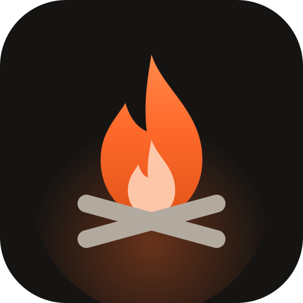
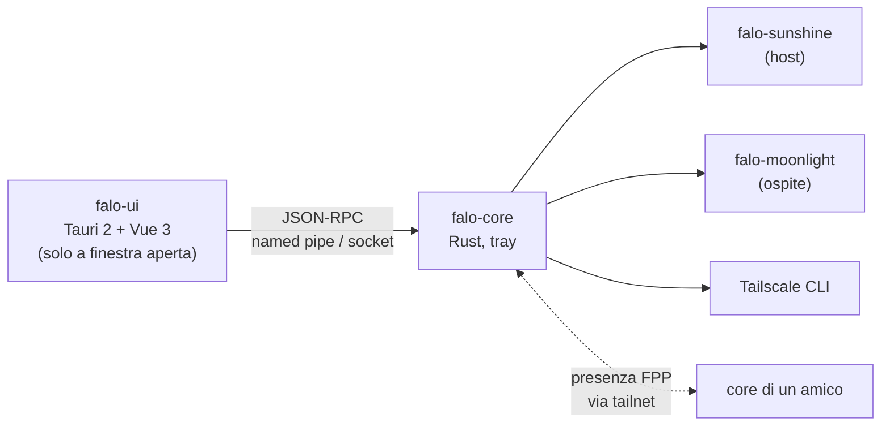

<p align="center">
  
</p>

<h1 align="center">Falò</h1>

<p align="center">
  Gioca in streaming con gli amici, senza server di mezzo.<br/>
  Un'app leggera per Windows 11 e macOS che unisce <a href="https://github.com/LizardByte/Sunshine">Sunshine</a>, <a href="https://github.com/moonlight-stream/moonlight-qt">Moonlight</a> e <a href="https://tailscale.com">Tailscale</a>.
</p>

<p align="center">
  <a href="LICENSE"></a>
  
</p>

---

## Cos'è

Falò è un orchestratore: configura e avvia motori di streaming maturi (Sunshine come host, Moonlight come client) e usa Tailscale come rete privata cifrata. Sopra aggiunge quello che manca per giocare tra amici come su Parsec: **profili, lista amici, inviti con un link e permessi parziali** (chi può usare controller, tastiera, mouse).

- **Un'unica app**: scarichi solo Falò, crei il profilo, inviti un amico e giocate. Niente da installare o configurare a mano: motori e rete arrivano con Falò.
- **Zero overhead in gioco**: durante lo streaming la finestra di Falò non esiste; resta solo un demone da pochi MB.
- **Nessun server nostro**: i dati tra amici viaggiano peer-to-peer dentro la tailnet.
- **Sicuro per costruzione**: nessuna porta esposta su Internet, ogni messaggio tra amici è firmato, i permessi si applicano sull'host.

> [!NOTE]
> Il progetto è alla milestone **M0 · Fondamenta**: c'è lo scheletro funzionante (core nel tray, IPC, configurazione, UI con design system), ma non si può ancora giocare. Lo streaming arriva con M1. Vedi [TODO.md](TODO.md).

## Documentazione

| Documento | Contenuto |
| --- | --- |
| [docs/falo-spec.md](docs/falo-spec.md) | **Specifica completa**, fonte di verità: architettura, protocolli, sicurezza, roadmap |
| [DESIGN_SYSTEM.md](DESIGN_SYSTEM.md) | Colori, tipografia, componenti, regole SCSS |
| [TODO.md](TODO.md) | Stato delle milestone e lavoro aperto |
| [docs/ipc.md](docs/ipc.md) | Contratto JSON-RPC tra core e UI |
| [docs/adr/](docs/adr/) | Decisioni di architettura (ADR) |
| [CONTRIBUTING.md](CONTRIBUTING.md) | Convenzioni, commit, fork dei motori |
| [SECURITY.md](SECURITY.md) | Come segnalare una vulnerabilità |

## Architettura in breve



## Struttura del repository

```text
apps/
  core/            demone Rust: tray, IPC, orchestrazione
  ui/              Tauri 2 + Vue 3 + SCSS, avviata su richiesta
crates/
  falo-proto/      identità Ed25519, profili firmati, permessi, inviti, schema IPC
  falo-net/        provider di rete (Tailscale) e Dottore di rete
  falo-store/      config.toml validato e SQLite con migrazioni
  falo-engines/    sunshine.conf, argomenti di Moonlight, processi
engines/           fork di Sunshine e Moonlight (submodule, da aggiungere)
packaging/         installer Windows e bundle macOS
docs/              specifica, ADR, guide
scripts/           sviluppo, test di fumo, sync dei fork
```

## Sviluppo

Requisiti: Rust stable (1.85+), Node.js 20+, su Windows i Build Tools di Visual Studio con il carico «Sviluppo di applicazioni desktop C++» e WebView2 (già presente in Windows 11). Tailscale serve per le funzioni di rete.

```bash
npm --prefix apps/ui install
```

Test e controlli:

```bash
cargo test --workspace
```

```bash
cargo clippy --workspace --all-targets -- -D warnings
```

```bash
npm --prefix apps/ui run typecheck && npm --prefix apps/ui test
```

Avvio in sviluppo: prima il core (icona nel tray), poi la finestra.

```bash
cargo run -p falo-core
```

```bash
cd apps/ui && npx tauri dev
```

Solo interfaccia nel browser, con un core simulato:

```bash
npm --prefix apps/ui run dev
```

Con il core avviato, `node scripts/ipc-smoke.mjs` prova l'IPC dalla riga di comando.

## Licenza

Falò è software libero sotto licenza [GPL-3.0](LICENSE), come Sunshine e Moonlight da cui deriva. Tailscale è il client ufficiale, installato da Falò in automatico; ognuno usa il proprio account. Nome, logo e icone sono originali.
