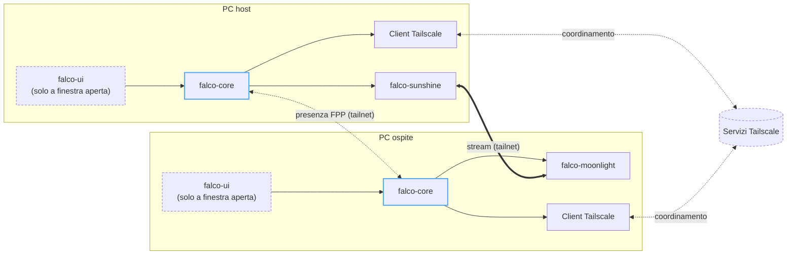
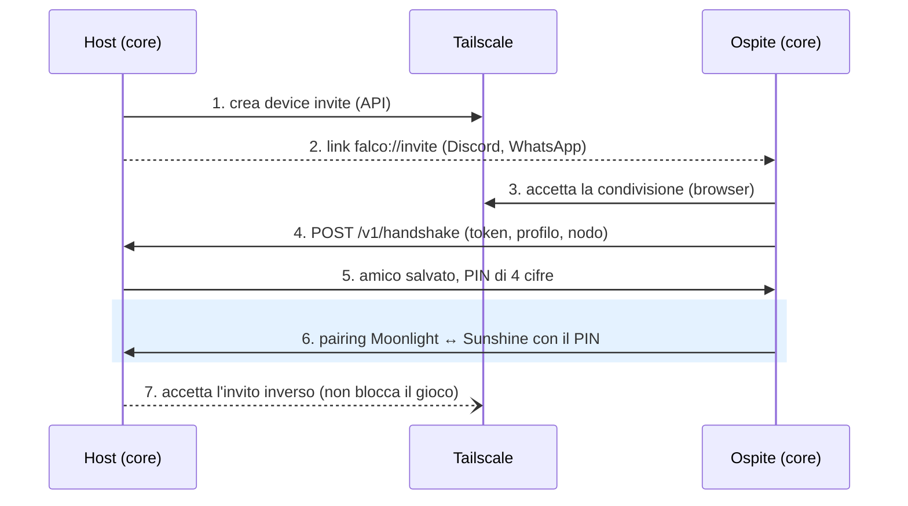
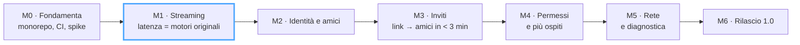

# Falco — Documento di sviluppo

Nov 17, 2026 · @Marco · fonte di verità del progetto (§18)

## 1. Visione e obiettivi

Falco è un'app desktop per Windows 11 e macOS per giocare in streaming con gli amici come su Parsec, senza server gestiti da noi. Unisce in una sola interfaccia leggera Sunshine come host, Moonlight come client e Tailscale come rete privata. Sopra questi tre pezzi aggiunge profili, amici, inviti e permessi parziali.

**Obiettivi**

- **Un'unica app:** installi, crei il profilo, inviti un amico e giocate. L'utente non configura mai a mano Sunshine, Moonlight o Tailscale.
- **Nessuna installazione manuale:** l'utente scarica solo Falco. Motori, driver e rete arrivano con il pacchetto o vengono installati da Falco in automatico; l'utente al massimo conferma con un clic (UAC, permessi di sistema, login). Vincolo deciso il 2026-11-18, vedi ADR 0012.
- **Prestazioni prima di tutto:** l'app non aggiunge latenza e, mentre si gioca, non consuma risorse in modo misurabile.
- **Rete automatica ma configurabile:** default automatici, un pannello avanzato con ogni parametro e una diagnostica che dice cosa non va e come risolverlo.
- **Identità sociale leggera:** nome, immagine profilo, lista amici, inviti con permessi parziali.
- **Nessun server proprio:** il coordinamento è delegato a Tailscale, i dati tra amici viaggiano peer-to-peer.

**Fuori dalla v1**

- Controller virtuali con host su macOS: è un limite della piattaforma (vedi §14). Un Mac host offre solo vista, tastiera e mouse.
- Client mobile, Linux o browser.
- Chat testuale o vocale: si usa Discord.
- Relay o cloud gaming propri.

**Principi guida**

1. **Zero overhead in gioco:** durante lo streaming la finestra UI viene distrutta e resta solo un demone minimo.
2. **Riusare, non riscrivere:** fork minimi di progetti maturi, con patch piccole e facili da riallineare a upstream.
3. **Default intelligenti, controllo totale:** ogni scelta automatica è visibile e si può sovrascrivere.
4. **Sicuro per costruzione:** di default nessuna porta esposta su Internet, tutto passa nella tailnet cifrata.
5. **Spiegare, non mostrare errori:** ogni problema ha un messaggio umano e un'azione concreta.

**Glossario**

| Termine | Significato |
| --- | --- |
| Host | Chi condivide il proprio PC e i propri giochi |
| Ospite | Amico che si collega a un host |
| Sessione | Uno streaming attivo da un host verso uno o più ospiti |
| Tailnet | La rete privata Tailscale di un utente |
| DERP | Relay di Tailscale, usato quando la connessione diretta fallisce (latenza più alta) |
| Core | Il demone Rust di Falco che orchestra tutto |

## 2. Architettura

Falco è un orchestratore: due processi propri, core e UI, configurano e avviano due motori esistenti, Sunshine e Moonlight, e usano Tailscale come rete. Nessun byte di gioco passa dal codice di Falco.



Il colore d'accento segna il codice nuovo di Falco; i bordi tratteggiati indicano ciò che esiste solo a tratti (la UI) o che non è nostro (i servizi Tailscale). Presenza e stream passano entrambi dentro la tailnet.

**Componenti**

| Componente | Responsabilità | Quando è attivo |
| --- | --- | --- |
| `falco-core` | Tray, identità, amici, inviti, permessi, rete, server di presenza, controllo dei motori | Sempre, avviato con il sistema |
| `falco-ui` | Finestra Tauri: legge e modifica lo stato tramite il core | Solo quando la finestra è aperta |
| `falco-sunshine` | Cattura schermo e audio, codifica hardware, ricezione input, applicazione permessi | Solo quando l'host è «Disponibile» |
| `falco-moonlight` | Decodifica hardware, finestra dello stream, invio input | Solo durante una sessione da ospite |
| Client Tailscale | Rete WireGuard, indirizzi `100.x`, attraversamento NAT | Installato e aggiornato da Falco in automatico (ADR 0012) |

**Contratto IPC tra core e UI**

JSON-RPC 2.0 sulla pipe locale. La UI chiama metodi e riceve eventi; non parla mai direttamente con Tailscale, Sunshine o Moonlight.

| Tipo | Esempi |
| --- | --- |
| Metodi | `state.snapshot`, `profile.update`, `friends.list`, `friend.setPermissions`, `invite.create`, `invite.accept`, `session.join`, `host.setAvailable`, `net.runDoctor` |
| Eventi | `presence.changed`, `invite.progress`, `session.knock`, `session.stats`, `session.ended`, `net.warning` |

**Ciclo di vita di una sessione**

1. L'ospite preme «Entra»; la UI chiama `session.join`.
2. Il core dell'ospite bussa all'host via FPP; l'host approva, o lo fa da solo se il ruolo ha `autoJoin`.
3. Il core dell'ospite chiude la UI, lancia `falco-moonlight stream` e legge lo stato JSON da stdout.
4. Durante lo stream il core sospende il polling e inoltra solo `session.stats` se la UI viene riaperta.
5. Alla fine il core registra la sessione in SQLite e riapre la UI con il riepilogo, se l'utente lo ha scelto.

## 3. Stack, licenze e struttura del repository

Falco è scritto in Rust per il core, Vue 3 dentro Tauri 2 per l'interfaccia e C++ per i due motori di streaming, che sono fork. Tutto il progetto è rilasciato in GPL-3.0, perché Sunshine e Moonlight lo richiedono.

| Livello | Tecnologia | Perché |
| --- | --- | --- |
| Core (demone) | Rust stable, `tokio` single-thread, `tray-icon` + `muda` | Nessuna webview: in tray occupa pochi MB e zero CPU |
| UI | Tauri 2 + Vue 3 + TypeScript + Vite + SCSS | Webview di sistema (WebView2 / WKWebView), bundle piccolo, stack web già noto |
| IPC core ↔ UI | JSON-RPC 2.0 su named pipe (Windows) o socket Unix (macOS), crate `interprocess` | Locale, senza porte TCP aperte |
| Host | Fork di [Sunshine](https://github.com/LizardByte/Sunshine) (C++) | Encoder hardware, protocollo maturo, API REST locale |
| Client | Fork di [moonlight-qt](https://github.com/moonlight-stream/moonlight-qt) (C++/Qt 6) | Decoder hardware, CLI per pairing e streaming |
| Rete | Client ufficiale Tailscale (pilotato via CLI `--json`) + Tailscale API | Rete WireGuard a livello kernel, nessun server nostro |
| Presenza | Server HTTP minimale (`hyper`) legato solo all'IP Tailscale | Scambio profili e stato tra amici |
| Dati | SQLite (`rusqlite` bundled) + config TOML | Un file, transazioni, zero servizi |
| Segreti | Portachiavi di sistema (crate `keyring`) | Credential Manager su Windows, Keychain su macOS |
| Immagini | crate `image` + `webp` | Avatar ridimensionati e compressi in locale |

**Licenze**

- Sunshine, moonlight-qt e Apollo sono GPL-3.0: i fork e Falco restano GPL-3.0, con sorgenti pubblici a ogni rilascio.
- Tailscale non viene ricompilato dentro Falco: Falco scarica e installa in automatico il client ufficiale (o usa la libreria `tsnet`, da decidere nell'ADR 0012); l'utente usa il proprio account e non installa nulla a mano.
- Il piano gratuito Personal di Tailscale è pensato per uso non commerciale ([prezzi Tailscale](https://tailscale.com/docs/account/manage-plans/free-plans-discounts)). Per un uso tra amici va bene; se Falco diventasse un prodotto a pagamento, ogni utente resta comunque sul proprio account.
- Nome, logo e icone devono essere originali: nessun asset di Parsec, Moonlight o Sunshine.

**Struttura del monorepo**

```text
falco/
  apps/
    core/            # demone Rust: tray, orchestrazione, presenza, rete
    ui/              # Tauri 2 + Vue 3 + SCSS, avviata su richiesta
  crates/
    falco-proto/      # tipi condivisi, schema IPC, firme Ed25519
    falco-net/        # provider di rete e diagnostica
    falco-store/      # SQLite, migrazioni, config
    falco-engines/    # controllo processi Sunshine e Moonlight
  engines/
    sunshine/        # submodule → fork falco-sunshine
    moonlight/       # submodule → fork falco-moonlight
  packaging/
    windows/         # installer NSIS, regole firewall, driver gamepad
    macos/           # bundle .app universal, entitlements, notarizzazione
  docs/              # questo documento, ADR, guide
  scripts/           # build, release, sync dei fork con upstream
```

**Regole sui fork**

- Ogni modifica a Sunshine o Moonlight sta in un branch `falco/*` con commit piccoli e titolati, così il rebase su upstream resta fattibile.
- Prima di patchare, controllare se upstream offre già un'opzione di configurazione o una API.
- Uno script `scripts/sync-upstream` fa il rebase, compila e lancia i test di fumo.

## 4. Profili e identità

Ogni utente è una coppia di chiavi Ed25519 generata al primo avvio: la chiave pubblica è il suo ID, mentre nome e immagine profilo sono dati firmati che gli amici verificano. Non serve nessun account Falco.

**Dati del profilo**

| Campo | Regole |
| --- | --- |
| `id` | Chiave pubblica Ed25519, codificata base32 senza padding |
| `tag` | Impronta breve mostrata in UI, formato `#K7QM-2XPA` (primi 8 caratteri dello SHA-256 dell'ID) |
| `name` | 2–24 caratteri Unicode, spazi ai bordi rimossi, niente caratteri di controllo |
| `avatar` | WebP 256×256, massimo 64 KB, ritagliato a cerchio in UI; identificato dal suo SHA-256 |
| `accent` | Colore derivato dall'hash dell'ID, usato per il monogramma se manca l'avatar |
| `status` | `online`, `busy`, `invisible` (scelto dall'utente; in UI «Online», «Occupato», «Invisibile») |
| `devices` | Elenco dei dispositivi: ID nodo Tailscale, nome, sistema operativo, `canHost` |
| `updatedAt` / `sig` | Data di modifica e firma Ed25519 dell'intero record |

**Regole**

- La chiave privata vive solo nel portachiavi di sistema e non lascia mai il dispositivo, tranne nel collegamento di un secondo dispositivo.
- Il record del profilo è serializzato in JSON canonico (chiavi ordinate) prima della firma, così la verifica è deterministica.
- Un amico accetta un profilo aggiornato solo se la firma è valida e `updatedAt` è più recente di quello in cache.
- L'avatar viene scaricato una volta e messo in cache per hash: se l'hash non cambia, nessun nuovo download.
- Avatar scelto dall'utente: il core lo decodifica, lo ritaglia, lo ridimensiona e lo ricomprime in WebP qualità 80, riducendo fino a stare sotto i 64 KB. I metadati EXIF vengono rimossi.

**Più dispositivi, una persona**

Marco può usare la stessa identità sul PC Windows e sul MacBook. Dal primo dispositivo sceglie «Collega un dispositivo», il secondo mostra un codice di 6 cifre e la chiave viaggia cifrata dentro la tailnet di Marco. Gli amici vedono una sola persona con due dispositivi, e possono collegarsi solo a quelli con `canHost` attivo.

**Esportazione e ripristino**

Dalle impostazioni si esporta un file `.falco-id` cifrato con una passphrase (Argon2id + XChaCha20-Poly1305). Senza quel file, reinstallare l'app significa creare un'identità nuova e ricevere di nuovo gli inviti.

## 5. Amici e presenza

Un'amicizia è una condivisione reciproca di dispositivi su Tailscale più un record firmato in SQLite. Lo stato online e i profili viaggiano direttamente tra i due core, attraverso la tailnet.

**Perché la condivisione deve essere reciproca**

Tailscale mette in quarantena i dispositivi condivisi: possono ricevere connessioni ma non avviarle, a meno che entrambe le parti si condividano i dispositivi a vicenda ([documentazione sharing](https://tailscale.com/docs/features/sharing)). Per questo ogni amicizia condivide in entrambe le direzioni il dispositivo su cui gira Falco. Così ognuno può vedere lo stato dell'altro e ospitarlo.

**Stati di un amico**

| Stato | Quando | In UI |
| --- | --- | --- |
| Sta giocando, posti liberi | Ospita una sessione con posti disponibili | Primo in lista, pulsante «Entra» |
| Online | Core raggiungibile, nessuna sessione | Pallino verde |
| Occupato | Impostato dall'utente o in gioco senza posti | Pallino ambra, niente richieste |
| Offline | Nodo Tailscale offline o core non risponde | Grigio, «visto 2 ore fa» |
| In attesa | Invito accettato, condivisione non ancora reciproca | Badge «in attesa» |
| Bloccato | Bloccato dall'utente | Nascosto, gestibile dalle impostazioni |

**Protocollo di presenza (FPP v1)**

Il core espone un piccolo server HTTP sulla porta 47900 (configurabile), legato solo agli indirizzi Tailscale del dispositivo (`100.x.y.z` e `fd7a:…`). Non è mai in ascolto su LAN o Internet.

| Endpoint | Scopo |
| --- | --- |
| `GET /v1/profile` | Profilo firmato (§4) |
| `GET /v1/avatar/{sha256}` | Avatar WebP, cache permanente per hash |
| `GET /v1/presence` | Stato, sessione attiva, gioco, posti liberi; risponde 304 se nulla è cambiato |
| `POST /v1/handshake` | Conclusione di un invito (§6), unico endpoint aperto a non-amici |
| `POST /v1/session/knock` | Un ospite chiede di entrare; long-poll fino a 30 s per la risposta dell'host |
| `POST /v1/session/notify` | L'host avvisa un amico: «ti invito a giocare ora» |
| `POST /v1/friend/remove` | Notifica di rimozione dell'amicizia |

**Autenticazione di ogni richiesta**

- Header `X-Falco-Id`, `X-Falco-Ts` e `X-Falco-Sig`. La firma copre metodo, percorso, timestamp e SHA-256 del corpo.
- Il server rifiuta un timestamp fuori di ±60 s e qualsiasi ID non presente tra gli amici, tranne su `/v1/handshake`.
- Doppio vincolo: l'IP sorgente, risolto con `tailscale whois`, deve appartenere a un nodo registrato per quell'amico.
- Limite di 20 richieste al minuto per IP, oltre il quale si risponde 429.

**Frequenza degli aggiornamenti**

| Contesto | Stato peer Tailscale | Presenza degli amici online |
| --- | --- | --- |
| UI aperta | Ogni 10 s | Ogni 15 s, con ETag |
| Solo tray | Ogni 60 s | Ogni 60 s, solo amici preferiti |
| Durante lo streaming | Sospeso | Sospeso, tranne la sessione attiva |

La v1 legge lo stato con `tailscale status --json`. Un'ottimizzazione da M5 sostituisce il polling con la sottoscrizione agli eventi della LocalAPI di Tailscale.

**Tabelle SQLite**

```sql
CREATE TABLE friends (
  id TEXT PRIMARY KEY, tag TEXT, name TEXT, avatar_hash TEXT, accent TEXT,
  state TEXT CHECK (state IN ('pending','friend','blocked')),
  favorite INTEGER DEFAULT 0, added_at INTEGER, last_seen INTEGER
);
CREATE TABLE friend_devices (
  friend_id TEXT REFERENCES friends(id) ON DELETE CASCADE,
  ts_node_id TEXT PRIMARY KEY, ts_ip TEXT, hostname TEXT, os TEXT,
  can_host INTEGER, shared_in INTEGER, shared_out INTEGER
);
CREATE TABLE session_log (
  id INTEGER PRIMARY KEY, friend_id TEXT, role TEXT, started_at INTEGER,
  ended_at INTEGER, avg_rtt_ms REAL, path TEXT  -- 'direct' | 'derp'
);
```

**Rimozione e blocco**

Rimuovere un amico agisce su tre livelli, nell'ordine: rifiuto immediato nel server di presenza, revoca del pairing del suo client in Sunshine, revoca della condivisione Tailscale. I primi due hanno effetto subito anche se la revoca su Tailscale fallisce.

## 6. Sistema inviti

Un invito è un link firmato che l'host incolla su Discord o WhatsApp: l'amico lo apre, preme «Accetta», conferma la condivisione su Tailscale, e in meno di 30 secondi i due sono amici e il pairing di Moonlight è già fatto. L'ospite fa tre clic, l'host uno.

**Preparazione una tantum dell'host**

Per creare inviti in automatico il core usa la Tailscale API. L'onboarding guida l'host a creare un OAuth client nella pagina Trust credentials della console Tailscale, con gli scope `devices:core:read` e `device_invites`. Gli OAuth client non scadono ([Tailscale API](https://github.com/tailscale/tailscale/blob/main/api.md)), quindi l'operazione si fa una volta sola. Client ID e secret vanno nel portachiavi.

Modalità manuale, senza OAuth: Falco apre la finestra Share del dispositivo nella console, l'host copia il link di condivisione e lo incolla nel modulo dell'invito. Costa due clic in più.

**Creazione dell'invito (host)**

1. L'host preme «Invita» e sceglie un ruolo (§7), la validità (1 ora, 24 ore, 7 giorni) e gli usi (1 di default, fino a 10).
2. Il core genera un token casuale di 32 byte e salva solo il suo SHA-256.
3. Il core chiama `POST /api/v2/device/{deviceId}/device-invites` con `multiUse` e `allowExitNode: false`, e riceve `inviteUrl`. I link Tailscale non usati scadono dopo 30 giorni; Falco applica comunque la sua scadenza, più breve.
4. Il core costruisce il payload, lo firma con la chiave dell'host, lo comprime (zstd) e lo codifica in base64url.
5. La UI mostra il link `falco://invite/…` con «Copia» e un'anteprima di cosa vedrà l'amico.

```json
{
  "v": 1,
  "host": { "id": "…", "name": "Marco", "tag": "#K7QM-2XPA" },
  "ts": { "inviteUrl": "https://login.tailscale.com/…", "node": "marco-pc", "ip": "100.101.102.103" },
  "token": "base64url(32 byte)",
  "role": "giocatore",
  "exp": 1763500000,
  "sig": "base64url(firma Ed25519)"
}
```

**Accettazione (ospite)**

1. L'invito arriva in tre modi: clic sul link `falco://`, incolla nel campo «Ho un invito», oppure rilevamento automatico negli appunti quando la finestra prende il focus («Hai un invito di Marco negli appunti»). Molte chat non rendono cliccabili gli schemi personalizzati, quindi il rilevamento negli appunti è il percorso principale.
2. Il core verifica firma e scadenza, poi mostra una scheda con nome, tag e permessi descritti a parole.
3. Se Tailscale manca, Falco lo installa da solo; se non è collegato, apre il login nel browser.
4. Falco apre `inviteUrl` nel browser: l'ospite accetta la condivisione su Tailscale. Il core controlla `tailscale status --json` ogni 2 s, fino a 5 minuti, finché il nodo dell'host compare.
5. Il core chiama `POST /v1/handshake` sull'host, inviando il token, il proprio profilo firmato e il proprio ID nodo.
6. L'host verifica token, scadenza e usi rimasti, e controlla con `tailscale whois` che l'IP sorgente sia un nodo condiviso. Se l'invito richiede approvazione, l'host vede una notifica «Luca vuole unirsi».
7. L'host salva l'amico con il ruolo dell'invito e risponde con un PIN di 4 cifre generato al momento.
8. Pairing automatico: l'ospite lancia `moonlight pair <ip> --pin <PIN>`, mentre l'host invia lo stesso PIN a Sunshine (`POST /api/pin`, con il nome dell'amico) riprovando ogni 500 ms per 15 s. L'host associa l'impronta del certificato client all'ID dell'amico.
9. Condivisione inversa: il core dell'ospite crea un invito Tailscale per il proprio dispositivo e lo passa nell'handshake. L'host lo accetta con un clic su una notifica. Finché non lo fa, l'amicizia resta «in attesa» ma si può già giocare.

**Regole**

- Default: un solo uso, scadenza 24 ore, approvazione dell'host obbligatoria quando gli usi sono più di uno.
- «Inviti attivi» elenca ogni invito con usi e scadenza. «Revoca» cancella l'invito Tailscale e invalida il token.
- Il link è un segreto al portatore: la UI lo dice chiaramente e non lo salva mai nei log.
- Se due persone usano lo stesso link a uso singolo, vince la prima: la seconda riceve «invito già usato».
- Il CLI di Moonlight supporta il pairing dalla versione 4.2.0 ([note di rilascio](https://newreleases.io/project/github/moonlight-stream/moonlight-qt/release/v4.2.1)). Se il flag `--pin` non c'è nella versione di base, va aggiunto nel fork.



Solo il passo 3 richiede il browser; il passo 7 è tratteggiato perché non blocca il gioco. Il pairing (in evidenza) è il punto in cui l'host lega il certificato di Moonlight all'ID dell'amico, e da lì valgono i permessi.

## 7. Permessi parziali

Ogni amico ha un ruolo preimpostato che l'host può rifinire permesso per permesso, anche durante una sessione. I permessi sono applicati dentro il fork di Sunshine, non nella UI dell'ospite: un client modificato non può aggirarli.

**Ruoli preimpostati**

| Permesso | Spettatore | Giocatore | Co-pilota | Fidato |
| --- | --- | --- | --- | --- |
| Vedere e sentire lo stream | sì | sì | sì | sì |
| Controller (numero massimo) | 0 | 1 | 2 | 4 |
| Tastiera | no | no | sì, scorciatoie di sistema bloccate | sì |
| Mouse | no | no | sì | sì |
| Entrare senza approvazione | no | sì | sì | sì |
| Avviare o cambiare app | no | no | no | sì |
| Appunti condivisi (v2) | no | no | no | sì |
| Terminare la sessione dell'host | no | no | no | sì |

**Permessi granulari**

| Chiave | Tipo | Effetto lato host |
| --- | --- | --- |
| `view` | bool | Senza, la connessione viene rifiutata |
| `audio` | bool | Senza, il canale audio non parte |
| `gamepads` | 0–4 | Pacchetti di controller con indice oltre il limite scartati |
| `keyboard` | bool | Pacchetti tastiera scartati |
| `keyboardSystemKeys` | bool | Se falso, scarta Win, Alt+Tab, Alt+F4, Cmd+Q, Cmd+Tab |
| `mouse` | bool | Movimento, clic e rotella scartati |
| `launchApps` | bool | Può vedere l'elenco delle app e avviarne una diversa |
| `autoJoin` | bool | Se falso, ogni ingresso passa da «bussa» e approvazione |
| `maxResolution` / `maxFps` / `maxBitrateKbps` | numeri | Richieste del client ridotte al limite |
| `schedule` | fasce orarie | Fuori fascia, la connessione viene rifiutata con un messaggio |
| `expiresAt` | data | Dopo la scadenza il ruolo torna a Spettatore |

**Dove si applicano**

- Il fork di Sunshine mantiene una mappa in memoria «impronta certificato client → permessi», aggiornata dal core tramite un nuovo endpoint locale `PUT /api/falco/clients/{uuid}/permissions`.
- Il controllo avviene in quattro punti: avvio della sessione (`view`, `autoJoin`, `schedule`), negoziazione dello stream (limiti di qualità), gestore degli input (`gamepads`, `keyboard`, `mouse`) e avvio delle app (`launchApps`).
- Un cambio di permessi durante la sessione ha effetto entro 100 ms, senza riconnessione.
- Base di partenza: il sistema di permessi per client di [Apollo](https://github.com/ClassicOldSong/Apollo), un fork di Sunshine sotto GPLv3. Si porta la logica, non l'interfaccia. Il default è «nega tutto tranne vedere», come in Apollo, dove i nuovi client ricevono solo la visione dello stream e l'elenco delle app.

**Controlli rapidi in sessione (stile Parsec)**

Durante una sessione l'host vede una piccola barra con un chip per ogni ospite: avatar, nome, e tre interruttori per controller, tastiera e mouse, più «Espelli». La barra si apre con `Ctrl+Shift+F` (`Cmd+Shift+F` su macOS) e non resta sopra il gioco quando è chiusa.

**Bussare**

Se `autoJoin` è falso, l'ospite preme «Entra» e l'host riceve una notifica di sistema con «Accetta» e «Rifiuta». Dopo 30 secondi senza risposta, la richiesta scade e l'ospite vede «Marco non ha risposto».

## 8. Motore di streaming

Il core non tocca mai i pacchetti video: genera la configurazione di Sunshine, lancia Moonlight con i parametri giusti e legge il loro stato. Tutta la latenza resta nel codice C++ maturo dei due motori.

### 8.1 Host: falco-sunshine

- Il core genera `sunshine.conf` e `apps.json` nella cartella dati di Falco e avvia Sunshine passando quel file. L'utente non vede mai l'interfaccia web di Sunshine.
- Credenziali dell'interfaccia web casuali, impostate all'installazione con `sunshine --creds`, salvate nel portachiavi; `origin_web_ui_allowed = pc`.
- Sunshine gira solo quando l'host è «Disponibile». Da «Non disponibile» il processo viene fermato, non messo in pausa.
- Su Windows Sunshine gira come servizio: serve per catturare le richieste UAC e la schermata di blocco. Il core lo avvia e lo arresta tramite Service Control Manager.
- L'elenco app parte da «Desktop» e dai launcher rilevati (Steam Big Picture, Epic, Battle.net). L'host aggiunge giochi con nome, eseguibile e copertina.

**Configurazione generata (valori di default)**

| Chiave Sunshine | Default Falco | Note |
| --- | --- | --- |
| `encoder` | auto | `amdvce` su GPU AMD, `nvenc` su NVIDIA, `quicksync` su Intel, `videotoolbox` su Mac |
| `channels` | 3 | Ospiti contemporanei; ogni ospite costa una codifica in più |
| `upnp` | disabled | Non serve con Tailscale; attivo solo nel provider Diretto |
| `fec_percentage` | 20 | Più alto su reti con perdite |
| `amd_usage` / `amd_rc` | `ultralowlatency` / `cbr` | Preset per latenza minima su GPU AMD |
| `amd_quality` / `amd_preanalysis` | `speed` / disabled | Meno lavoro per frame |
| `vt_realtime` | enabled | VideoToolbox in modalità tempo reale |
| `hevc_mode` / `av1_mode` | auto | Decide la capacità del client |
| `gamepad` | `x360` | Solo Windows |
| `min_log_level` | warning | Meno scritture su disco |

I nomi delle chiavi vanno verificati sulla versione di Sunshine scelta. Ogni chiave è esposta anche nelle impostazioni avanzate (§15).

**Più ospiti nella stessa sessione**

Sunshine supporta più client in streaming insieme, e ognuno riceve la propria codifica. La UI mostra il costo stimato («ogni ospite in più usa circa un encoder in più») e si ferma al valore di `channels`. I controller di ogni ospite diventano controller virtuali separati, nel limite dei suoi permessi.

**Host su macOS**

Servono i permessi Registrazione schermo e Accessibilità. Le versioni recenti di Sunshine catturano l'audio su macOS con la Tap API ([GamingOnLinux](https://www.gamingonlinux.com/2026/05/sunshine-game-streaming-tool-adds-vulkan-encoding-plus-xdg-pipewire-and-kwin-direct-screencast-capture/page=1/)). L'emulazione di gamepad su un host macOS non è supportata ([tabella di compatibilità di Sunshine](https://gitee.com/zypdos/Sunshine)), quindi su Mac la UI nasconde i permessi controller.

### 8.2 Client: falco-moonlight

Il core avvia Moonlight dalla riga di comando, per esempio:

```bash
falco-moonlight stream 100.101.102.103 "Desktop" \
  --resolution 1920x1080 --fps 60 --bitrate 30000 \
  --video-codec HEVC --display-mode borderless \
  --frame-pacing --quit-after
```

I nomi dei flag vanno verificati con `moonlight stream --help` sulla versione forkata.

**Modifiche nel fork**

1. Flag `--pin` per il pairing, se manca nella versione di base.
2. Modalità senza finestra principale: si apre solo la finestra dello stream.
3. Stato leggibile dalla macchina su stdout, in JSON lines: `connecting`, `connected`, `stats` ogni 2 s, `ended` con il motivo.
4. Overlay statistiche Falco: ping, fps, bitrate, percorso diretto o relay.
5. Cartella di configurazione separata, per non scontrarsi con un Moonlight già installato.
6. Lettura dei permessi ricevuti, per disattivare in UI gli input non concessi con un messaggio chiaro.

**Parametri automatici**

| Parametro | Regola |
| --- | --- |
| Risoluzione | La più bassa tra schermo dell'host, schermo dell'ospite e limite dei permessi |
| FPS | Frequenza dello schermo dell'ospite, massimo 120, ridotta dal limite dei permessi |
| Codec | HEVC di default, AV1 solo se entrambi lo gestiscono in hardware, H.264 come ripiego |
| Bitrate | Percorso diretto in LAN 50 Mbps; diretto via Internet 60% della banda misurata in upload dell'host; relay DERP 8 Mbps con avviso |

Su Mac il decoder AV1 hardware è disponibile solo da M3 in poi ([note di Moonlight 6.2.0](https://newreleases.io/project/github/moonlight-stream/moonlight-qt/release/v6.2.0)): su un MacBook M1 il default resta HEVC.

## 9. Rete configurabile e diagnostica

Di default la rete è Tailscale e funziona da sola. Per i casi difficili Falco offre quattro provider intercambiabili, un «Dottore di rete» che spiega cosa non va, e ogni parametro esposto nelle impostazioni avanzate.

**Provider di rete**

Ogni provider implementa lo stesso trait Rust `NetworkProvider`: trovare i peer, risolvere l'indirizzo, preparare il firewall, lanciare la diagnostica.

| Provider | Quando usarlo | Cosa cambia |
| --- | --- | --- |
| Tailscale (default) | Sempre, salvo casi particolari | Rete WireGuard cifrata, attraversamento NAT automatico, relay DERP come ultima risorsa |
| LAN | Host e ospite nella stessa rete locale | Scoperta mDNS (`_falco._tcp`), nessun Tailscale necessario, latenza minima |
| Diretto | Utenti esperti con port forwarding o IPv6 pubblico | UPnP, NAT-PMP o PCP automatici, oppure porte aperte a mano; cifratura di Sunshine obbligatoria |
| Headscale | Chi vuole un proprio server di coordinamento | Stesso flusso di Tailscale, ma con URL di controllo personalizzato (`--login-server`) |

Con il provider LAN attivo, Falco preferisce la LAN a Tailscale quando entrambi i dispositivi sono nella stessa rete.

**Dottore di rete**

Si apre da Impostazioni → Rete, parte da solo al primo avvio da host e dopo ogni sessione con problemi. Ogni controllo produce un semaforo e, se serve, un'azione.

| Controllo | Come | Cosa misura |
| --- | --- | --- |
| Raggiungibilità UDP | `tailscale netcheck` | UDP libero, IPv4 e IPv6, NAT «difficile», UPnP/NAT-PMP/PCP disponibili, relay più vicino |
| Percorso verso l'amico | `tailscale ping` | Connessione diretta o via relay DERP, RTT |
| Porte di Sunshine | Connessione TCP e sonda UDP sulle porte dell'host | Firewall che blocca lo stream |
| Banda | Test di 3 s sul server di presenza (`/v1/speedtest`) | Upload dell'host, download dell'ospite |
| Jitter e perdite | 200 pacchetti UDP a 5 ms di distanza | Stabilità della linea |
| Postazione locale | API di sistema | Wi-Fi o cavo, banda Wi-Fi, risparmio energetico, altre VPN attive |

**Problemi tipici e soluzioni**

| Sintomo | Causa probabile | Falco fa da solo | Indicazione all'utente |
| --- | --- | --- | --- |
| Connessione via relay DERP, ping alto | NAT difficile su entrambi i lati o UDP bloccato | Avviso in sessione, bitrate ridotto | Attiva UPnP sul router, oppure inoltra la porta UDP 41641 al PC host |
| Scatti periodici | Wi-Fi con scansioni in background o banda 2,4 GHz | Rileva la banda Wi-Fi | Usa il cavo o la rete 5/6 GHz |
| Immagine a blocchi | Perdita di pacchetti | Alza la FEC al 30%, abbassa il bitrate | Chiudi download e streaming in corso |
| L'amico risulta offline | Tailscale disconnesso sul suo PC | Mostra «Tailscale di Luca è spento» | Chiedi a Luca di aprire Falco |
| Connessione rifiutata | Regola firewall mancante o cambiata | Ricrea la regola, chiedendo l'autorizzazione | Nessuna |
| Latenza alta solo in gioco | Un'altra VPN o un exit node attivo | Rileva l'exit node e lo segnala | Disattiva l'altra VPN durante il gioco |
| Rete dell'operatore con CGNAT | Nessun IPv4 pubblico | Preferisce IPv6 se disponibile | Nessuna: Tailscale gestisce il caso |

**Firewall**

- Windows: l'installer crea regole per `falco-sunshine.exe` limitate agli indirizzi remoti Tailscale (`100.64.0.0/10` e `fd7a:115c:a1e0::/48`), più la LAN se il provider LAN è attivo.
- Porte predefinite di Sunshine: TCP 47984, 47989, 48010 e UDP 47998–48000; l'interfaccia web 47990 resta solo locale. Da verificare sulla versione del fork.
- macOS: il firewall applicativo chiede il permesso al primo avvio; Falco lo spiega prima, nell'onboarding.

**Parametri di rete esposti**

| Parametro | Default | Valori |
| --- | --- | --- |
| Provider | Tailscale | Tailscale, LAN, Diretto, Headscale |
| Porta di presenza | 47900 | 1024–65535 |
| Porta base di Sunshine | 47989 | Le altre porte seguono con lo stesso scarto |
| Famiglia di indirizzi | Entrambe | Solo IPv4, solo IPv6, entrambe |
| UPnP / NAT-PMP | Disattivo | Attivo solo con il provider Diretto |
| FEC | 20% | 0–100% |
| Bitrate | Automatico | Automatico o fisso 1–150 Mbps |
| Tetto bitrate su relay | 8 Mbps | 2–30 Mbps |
| Marcatura QoS (DSCP 46) | Attiva su Windows | Attiva, disattiva |
| Ambito firewall | Solo tailnet | Solo tailnet, tailnet + LAN |
| Timeout di connessione | 10 s | 3–60 s |
| Riconnessione automatica | 3 tentativi | 0–10 |
| Avviso exit node attivo | Attivo | Attivo, disattivo |

## 10. Prestazioni e ottimizzazione

Falco non sta mai nel percorso dei pacchetti di gioco, quindi la latenza aggiunta deve essere zero rispetto a Sunshine e Moonlight originali. Il resto del lavoro è non consumare nulla quando non serve. I numeri qui sotto sono obiettivi da misurare in CI, non stime.

**Budget per stato**

| Stato | RAM del core | CPU media del core | Processi Falco attivi |
| --- | --- | --- | --- |
| In tray, non disponibile | ≤ 15 MB | \~0%, al massimo 1 risveglio al minuto | Solo il core |
| In tray, disponibile come host | ≤ 15 MB | < 0,5% | Core + Sunshine inattivo |
| Finestra aperta | Core ≤ 15 MB, totale con webview ≤ 150 MB | < 2% a UI ferma | Core + UI |
| In streaming | ≤ 15 MB | < 0,3% | Core + un motore; la UI non esiste |

| Metrica | Obiettivo |
| --- | --- |
| Latenza aggiunta rispetto a Sunshine + Moonlight originali | 0 ms, misurata con la stessa scena e lo stesso hardware |
| Avvio del core fino all'icona in tray | < 300 ms |
| Apertura della finestra fino al primo frame disegnato | < 800 ms a freddo, < 300 ms a caldo |
| Dimensione core + UI (motori esclusi) | < 15 MB |
| Scritture su disco durante lo streaming | Solo errori |

**Core**

- Runtime `tokio` single-thread; nessun ciclo attivo, timer raggruppati, tutto il polling sospeso durante lo streaming.
- Log con `tracing` su file a rotazione, livello `warn` di default, scrittura bufferizzata.
- Profilo di release: `opt-level = 3`, `lto = "fat"`, `codegen-units = 1`, `panic = "abort"`, `strip = true`.
- Dipendenze controllate con `cargo bloat` e `cargo deny`: ogni crate aggiunto deve giustificare il suo peso.

**UI**

- Processo separato (`falco-ui`): chiudere la finestra termina il processo e libera la webview. Alla riapertura la UI chiede al core uno snapshot dello stato e si idrata in meno di 50 ms.
- Vue 3 con `<script setup>`, nessuna libreria di componenti pesante, nessun CSS-in-JS a runtime.
- Animazioni solo su `transform` e `opacity`, rispetto di `prefers-reduced-motion`.
- Lista amici virtualizzata oltre 50 elementi, avatar con `loading="lazy"` e dimensioni fisse.
- Font: un solo font variabile in WOFF2 con sottoinsieme latino, sotto 50 KB, più lo stack di sistema come ripiego.

**Durante lo streaming**

- Su Windows il core alza la priorità dei processi: `HIGH_PRIORITY_CLASS` per Sunshine sull'host, `ABOVE_NORMAL_PRIORITY_CLASS` per Moonlight sull'ospite. Disattiva la modalità efficienza per entrambi.
- Prima di iniziare segnala le condizioni che peggiorano lo stream: portatile a batteria, piano energetico «risparmio», Wi-Fi a 2,4 GHz.
- Su macOS va verificato se la Modalità gioco si attiva sulla finestra di stream a schermo intero; se no, si documenta come limite.

**Come si misura**

- Un comando `falco bench` registra RAM, CPU e risvegli del core per 10 minuti in ciascuno dei quattro stati, e produce un JSON.
- La CI fallisce se la dimensione del pacchetto o l'avvio a freddo superano il budget del 10%.
- Il confronto di latenza si fa a mano a ogni milestone: telecamera a 240 fps che riprende schermo host e schermo ospite, stessa scena con e senza Falco.

## 11. Sicurezza

Di default nessuna porta di Falco o di Sunshine è raggiungibile da Internet: tutto passa nella tailnet cifrata con WireGuard, e ogni azione tra amici è firmata. I permessi si applicano sull'host, quindi un client modificato non guadagna nulla.

**Minacce e contromisure**

| Minaccia | Contromisura |
| --- | --- |
| Link di invito finito nelle mani sbagliate | Uso singolo, scadenza breve, approvazione dell'host per inviti multipli, revoca immediata |
| Amico con client modificato che supera i permessi | Controllo nel fork di Sunshine su sessione, input e qualità (§7) |
| Scansione delle porte di Sunshine da Internet | Firewall limitato agli indirizzi Tailscale; il provider Diretto richiede un consenso esplicito |
| Richieste di presenza falsificate | Firma Ed25519, finestra temporale ±60 s, verifica `tailscale whois`, limite di frequenza |
| Altro processo locale che parla col core | Named pipe con ACL del solo utente corrente (Windows), socket `0600` nella cartella utente (macOS) |
| Interfaccia web di Sunshine | Solo localhost, credenziali casuali nel portachiavi |
| Host malevolo che fa crashare il client | Fork di Moonlight sempre allineato; la 6.2.0 ha corretto tre CVE di questo tipo ([note di rilascio](https://newreleases.io/project/github/moonlight-stream/moonlight-qt/release/v6.2.0)) |
| Aggiornamento manomesso | Updater di Tauri con manifest firmato, pacchetti su GitHub Releases, firma del codice su entrambe le piattaforme |
| Dispositivo rubato | Identità nel portachiavi protetto dal login; gli amici possono bloccare l'ID; il dispositivo si rimuove dalla console Tailscale |

**Segreti e dove stanno**

| Segreto | Posizione |
| --- | --- |
| Chiave privata dell'identità | Portachiavi di sistema |
| Client ID e secret OAuth di Tailscale | Portachiavi di sistema |
| Credenziali web di Sunshine | Portachiavi di sistema |
| Token degli inviti | Solo SHA-256 in SQLite |

**Cifratura dello stream**

Il traffico è già cifrato da WireGuard dentro la tailnet. La cifratura di Sunshine resta al default upstream e diventa obbligatoria con il provider Diretto.

**Privacy**

- Nessuna telemetria. I rapporti di crash restano in locale; l'utente può esportarli con un clic per allegarli a una segnalazione.
- Il registro delle sessioni resta sul dispositivo e si cancella dalle impostazioni.
- Gli appunti condivisi (v2) sono disattivati di default e solo per il ruolo Fidato.

## 12. Design system

Lo stile è «volo notturno»: superfici grafite fredde, un solo colore d'accento (Cielo) usato con parsimonia, tipografia compatta e decisa. Il marchio è la testa di un falco pellegrino di profilo; la guida completa è in `DESIGN_SYSTEM.md`. Il colore indica sempre uno stato o un'azione, mai una decorazione.

**Principi visivi**

- Una sola azione primaria per schermata, sempre in accento con testo scuro.
- Gerarchia data da spazio e peso del testo, non da riquadri: bordi da 1 px, nessuna ombra pesante.
- L'alone accento si usa solo per ciò che è «vivo»: un amico in gioco, una sessione attiva.
- Tema scuro di default, tema chiaro che segue il sistema; entrambi rispettano il contrasto WCAG AA.

**Colori (tema scuro)**

| Token | Valore | Uso |
| --- | --- | --- |
| `$bg-0` | `#0B0D11` | Sfondo dell'app |
| `$bg-1` | `#12151B` | Barra laterale, pannelli |
| `$bg-2` | `#1A1E26` | Card, campi |
| `$bg-3` | `#242A34` | Hover, elementi selezionati |
| `$line` | `#2E3540` | Bordi e separatori da 1 px |
| `$text-1` | `#EEF1F5` | Testo principale |
| `$text-2` | `#A7B0BD` | Testo secondario |
| `$text-3` | `#8A93A0` | Etichette, testo disattivato |
| `$accent-500` | `#4CA6FF` | Accento «Cielo», azione primaria (testo sopra: `$bg-0`, contrasto circa 7,6:1) |
| `$accent-400` / `$accent-600` | `#79BCFF` / `#2B86E3` | Hover / premuto |
| `$accent-glow` | `rgba(76, 166, 255, .35)` | Alone degli stati vivi |
| `$eye` | `#F5A524` | Ambra dell'occhio del falco: solo marchio e illustrazioni |
| `$ok` | `#3DDC84` | Online, connessione diretta, ping buono |
| `$busy` | `#F5B83D` | Occupato, relay DERP, ping medio |
| `$danger` | `#FF4D5E` | Errori, espulsione, ping alto |

Tema chiaro: `$bg-0 #F4F6F9`, `$bg-1 #FFFFFF`, `$bg-2 #FAFBFD`, `$bg-3 #E9EDF2`, `$line #DCE2EA`, `$text-1 #12161C`, `$text-2 #4E5967`, `$text-3 #66707D`, `$accent-500 #1F7FE0`. I token SCSS puntano a custom property CSS, e il tema cambia con `data-theme` su `<html>`.

**Tipografia**

Un solo font variabile, [Geist](https://vercel.com/font) (licenza OFL), con sottoinsieme latino. I numeri delle statistiche usano `font-variant-numeric: tabular-nums`, così ping e fps non «ballano».

| Stile | Dimensione / interlinea | Peso | Uso |
| --- | --- | --- | --- |
| Display | 32 / 38 | 700, spaziatura -0,02em | Onboarding, schermate vuote |
| Titolo 1 | 24 / 30 | 650 | Titolo di pagina |
| Titolo 2 | 18 / 24 | 600 | Sezioni, nome nella scheda amico |
| Corpo | 14 / 20 | 450 | Testo standard |
| Piccolo | 13 / 18 | 450 | Testo secondario |
| Etichetta | 11 / 14 | 600, maiuscolo, spaziatura +0,06em | Intestazioni di gruppo |

**Spazi, raggi, movimento**

| Gruppo | Valori |
| --- | --- |
| Spaziatura (base 4) | 4, 8, 12, 16, 20, 24, 32, 40, 56 |
| Raggi | 6 campi piccoli, 10 pulsanti, 14 card, 20 finestre modali, 999 pillole e avatar |
| Durate | 120 ms hover, 200 ms pannelli, 320 ms modali |
| Curva | `cubic-bezier(.2, .8, .2, 1)`; con riduzione del movimento, durate a 0 |
| Finestra | Minimo 960×600, default 1120×720, barra del titolo personalizzata |
| Punti di rottura (larghezza finestra) | `sm` 1040, `md` 1280, `lg` 1600 |

**Componenti di base**

| Componente | Varianti e regole |
| --- | --- |
| Pulsante | Primario accento, secondario superficie, fantasma, pericolo; altezze 32, 40, 48 |
| Avatar | 24, 32, 40, 56, 96 px; anello di stato da 2 px con 2 px di stacco; monogramma su colore `accent` se manca l'immagine |
| Scheda amico | Avatar, nome, attività, azioni visibili all'hover; bordo e alone accento quando l'amico è in gioco |
| Chip ruolo | Icona + nome del ruolo, colore neutro; tooltip con i permessi a parole |
| Pillola ping | Verde sotto 30 ms, ambra 30–60 ms, rosso sopra 60 ms; etichetta «diretto» o «relay» |
| Riga diagnostica | Semaforo, titolo, valore misurato, azione |
| Interruttore, campo, menu, slider | Altezza 40, focus visibile con anello accento da 2 px |
| Toast | In basso a destra, massimo 2 visibili, 4 s, azione opzionale |
| Icone | [Lucide](https://lucide.dev) importate una per una, tratto 1,75 |

**Regole SCSS**

- File globali: `_tokens.scss` (variabili e mappe), `_mixins.scss`, `_base.scss`, `main.scss`. Ogni componente Vue usa `<style lang="scss" scoped>`.
- Nesting profondo e specificità alta: ogni componente parte dalla sua classe radice e annida tutto sotto di essa.
- Usare sempre variabili e mixin esistenti (`mq`, `surface`, `focus-ring`, `truncate`, `glow`, `avatar`), mai valori scritti a mano se esiste un token.
- Le regole responsive stanno dentro il singolo selettore annidato, con `@include mq(sm)`.
- Nomi di classe semplici, senza `--` e `__`: `.friend`, `.name`, `.actions`, stati come `.playing` o `.active`.
- Commenti brevi, massimo due righe.

```scss
// Card amico: stato, attività, azioni rapide
.friends {
  .friend {
    @include surface(2);
    display: grid;
    grid-template-columns: auto 1fr auto;
    align-items: center;
    gap: $sp-3;
    padding: $sp-3 $sp-4;
    border-radius: $r-card;
    transition: background $t-fast $ease;

    .avatar {
      @include avatar(40px);

      @include mq(sm) {
        @include avatar(32px);
      }
    }

    .info {
      min-width: 0;

      .name {
        @include truncate;
        font: 600 #{$fs-body}/1.3 $font;
        color: $text-1;
      }

      .activity {
        @include truncate;
        font-size: $fs-small;
        color: $text-2;
      }
    }

    .actions {
      display: flex;
      gap: $sp-2;
      opacity: 0;
      transition: opacity $t-fast $ease;

      @include mq(sm) {
        opacity: 1;
      }
    }

    &:hover {
      background: $bg-3;

      .actions {
        opacity: 1;
      }
    }

    // In gioco: bordo accento e alone sull'avatar
    &.playing {
      box-shadow: inset 0 0 0 1px $accent-500;

      .avatar {
        @include glow($accent-glow);
      }
    }
  }
}
```

## 13. Schermate e flussi UX

L'app ha una sola schermata principale, gli Amici, e tutto il resto si raggiunge in al massimo due clic. Il percorso che conta, «vedo un amico in gioco e entro», richiede un clic.

**Struttura della finestra**

- Barra laterale da 72 px con quattro icone: Amici, Ospita, Inviti, Impostazioni. In basso, avatar e stato dell'utente.
- Area centrale con il contenuto della sezione.
- Pannello destro da 320 px per i dettagli di un amico. Con il mixin `mq(sm)`, cioè sotto i 1040 px di larghezza, il pannello diventa un cassetto sovrapposto.
- Barra del titolo personalizzata, trascinabile; su macOS i semafori della finestra restano al loro posto.

**Schermate**

| Schermata | Contenuto | Azione primaria |
| --- | --- | --- |
| Onboarding | Benvenuto, profilo (nome e avatar), Tailscale (installato da Falco in automatico, l'utente fa solo il login), «Voglio anche ospitare?»; se sì: permessi di sistema, OAuth Tailscale guidato, Dottore di rete rapido | «Continua», obiettivo sotto i 3 minuti |
| Amici | Ricerca, gruppi «In gioco ora» (card grandi con gioco, posti liberi, avatar degli ospiti), «Online», «Offline» (chiuso di default) | «Entra» sulla card di chi gioca, «Invita» in alto |
| Dettaglio amico (pannello) | Avatar 96 px, nome, tag, dispositivi, chip del ruolo, permessi modificabili, ultime sessioni, rimuovi e blocca | «Chiedi di entrare» o «Invitalo a giocare» |
| Invita (modale) | Ruolo con riepilogo dei permessi, validità, usi, approvazione; poi link, «Copia», anteprima di ciò che vedrà l'amico | «Crea link» |
| Accetta invito (modale) | Scheda dell'host, permessi descritti a parole, poi tre passi con spunta: Tailscale, condivisione, pairing | «Accetta», poi «Siete amici» |
| Ospita | Interruttore «Disponibile per gli amici», griglia di app con copertine, sessione attiva con ospiti, encoder, bitrate, statistiche | «Termina sessione» quando è attiva |
| Inviti | Inviti attivi con usi e scadenza, storico | «Revoca» |
| Impostazioni | Schede: Profilo, Streaming, Rete, Host, Permessi predefiniti, Avanzate, Info | Salvataggio automatico con conferma discreta |
| Dottore di rete | Elenco dei controlli con semafori, valore misurato, azione suggerita | «Ripeti il test» |

**Fuori dalla finestra**

| Elemento | Contenuto |
| --- | --- |
| Menu del tray | Stato personale, «Disponibile», amici in gioco con «Entra», «Apri Falco», «Esci» |
| Notifiche di sistema | Richiesta di ingresso con «Accetta» e «Rifiuta», amico che inizia a giocare (solo preferiti), invito accettato |
| Overlay dello stream (ospite) | Pillola in alto a destra con ping, fps e percorso; si nasconde dopo 3 s |
| Barra rapida (host) | Chip per ogni ospite con interruttori di input ed «Espelli», aperta con la scorciatoia del §7 |
| Aggiornamenti | Notifica «È disponibile Falco X.Y» con pulsante «Aggiorna»; voce nel menu del tray; badge su Impostazioni → Info (vedi «Aggiornamenti automatici») |

**Aggiornamenti automatici**

- Il core controlla un manifest firmato su GitHub Releases all'avvio e poi ogni 6 ore, mai durante lo streaming.
- Default: scarica in background e installa da solo alla prossima chiusura o quando nessuna sessione è attiva, senza procedure manuali (installer NSIS in modalità silenziosa su Windows, sostituzione del bundle `.app` su macOS).
- L'utente vede una notifica con «Aggiorna ora» e «Più tardi»; da Impostazioni → Info può scegliere tra automatico, solo notifica o disattivato.
- Un aggiornamento aggiorna insieme core, UI e motori: le versioni sono sempre allineate.
- Un aggiornamento fallito non lascia l'app a metà: si torna alla versione precedente e la notifica spiega cosa fare.
- Dettagli e scelte in `docs/adr/0008-aggiornamenti-automatici.md`.

**Flusso principale: entrare a giocare**

1. Luca apre Falco (o il menu del tray) e vede Marco in «In gioco ora», con 2 posti liberi.
2. Preme «Entra». Se il suo ruolo ha `autoJoin`, lo stream parte; altrimenti Marco riceve la richiesta e la accetta.
3. La finestra di Falco si chiude da sola, si apre lo stream a schermo intero, e l'overlay mostra il percorso diretto con il ping.
4. Alla fine, Luca torna su Falco con un riepilogo: durata, ping medio, e un suggerimento se la qualità è stata scarsa.

**Stati vuoti ed errori**

- Nessun amico: illustrazione originale (un falco in planata a tratto), titolo «Qui saranno i tuoi amici», pulsante «Invita il primo».
- Errori sempre in tre parti: cosa è successo, perché probabilmente, cosa fare. Esempio: «Non riesco a raggiungere Marco. Il suo Tailscale sembra spento. Chiedigli di aprire Falco.»

**Testi e lingue**

- Italiano e inglese dalla v1, con un modulo i18n leggero e chiavi in JSON.
- Tono informale, con il tu, frasi brevi, nessun termine tecnico nelle schermate di base; i termini tecnici stanno nelle impostazioni avanzate.

**Accessibilità**

- Tutto si usa da tastiera, con focus visibile; aree cliccabili di almeno 32 px.
- Etichette ARIA su icone e pulsanti; lo stato non è mai indicato dal solo colore, ma anche da testo o icona.

## 14. Specifiche di piattaforma

Windows 11 è la piattaforma host completa; macOS è un client completo e un host limitato a vista, tastiera e mouse. Le differenze vivono tutte in moduli `platform/windows` e `platform/macos` del core, mai sparse nel codice.

| Aspetto | Windows 11 | macOS |
| --- | --- | --- |
| Versione minima | Windows 11 22H2, x64 (ARM64 in v2) | macOS 14; per ospitare 14.2 o successiva, come richiesto da Sunshine ([guida Sunshine 2026](https://tech-insider.org/sunshine-moonlight-streaming-setup-2026/)) |
| Pacchetto | Installer NSIS per tutto il sistema, una richiesta UAC | `.app` universal (arm64 + x86\_64) in un `.dmg` |
| Webview | WebView2, già presente in Windows 11 | WKWebView di sistema |
| Host | Sunshine come servizio di Windows | Sunshine come processo utente |
| Encoder | AMF (AMD), NVENC (NVIDIA), Quick Sync (Intel) | VideoToolbox |
| Controller virtuali | Sì, Xbox 360 tramite il driver installato con Sunshine | No: limite della piattaforma |
| Permessi di sistema | Regole firewall create dall'installer | Registrazione schermo, Accessibilità, Rete locale, Notifiche: ognuno spiegato prima della richiesta |
| Tailscale | MSI ufficiale installato in silenzio da Falco; CLI `tailscale.exe` | Versione Standalone installata da Falco; il core cerca la CLI dentro `Tailscale.app` |
| Link `falco://` | Plugin deep-link di Tauri, registrato nel registro | `CFBundleURLTypes` nell'`Info.plist` |
| Avvio con il sistema | Plugin autostart, avvio nel tray | `SMAppService` come elemento di login |
| Firma del codice | Certificato di firma del codice (per esempio Azure Trusted Signing); senza, SmartScreen avvisa | Apple Developer Program, Hardened Runtime, notarizzazione di ogni binario annidato |
| Moonlight nel pacchetto | Cartella `engines\moonlight` accanto all'eseguibile | App di supporto in `Contents/Helpers`, firmata a parte |

**Note per Windows**

- Il driver dei controller virtuali usato da Sunshine (ViGEmBus) non è più sviluppato. Funziona ancora, ma va tenuto d'occhio: se Sunshine cambia driver, il fork lo segue.
- Il servizio di Sunshine deve partire solo quando l'host è disponibile. Tipo di avvio «manuale», gestito dal core.
- La scheda video del PC host principale è AMD: i preset AMF del §8 sono il caso da testare per primo.

**Note per macOS**

- I permessi Registrazione schermo e Accessibilità richiedono il riavvio di Sunshine dopo la concessione: la UI lo fa da sola e lo dice.
- macOS 15 chiede il permesso Rete locale per la scoperta mDNS del provider LAN.
- Il MacBook Pro M1 di sviluppo copre il client con HEVC; AV1 in hardware richiede M3 o successivi.

## 15. Schema delle impostazioni

Tutte le impostazioni vivono in un unico `config.toml` gestito dal core: la UI è solo un editor di questo file. Un utente esperto può modificarlo a mano, e il core lo rilegge e lo valida a ogni salvataggio.

```toml
# config.toml di Falco, gestito dal core
schema = 1

[general]
language = "it"              # it | en
updates = "auto"             # auto | notify | off  (§13 «Aggiornamenti automatici»)
theme = "system"             # system | dark | light
start_with_system = true
start_minimized = true
close_to_tray = true

[profile]
status = "online"            # online | busy | invisible

[stream]                     # lato ospite
resolution = "auto"          # auto | "1280x720" | "1920x1080" | "2560x1440" | "3840x2160"
fps = "auto"                 # auto | 30 | 60 | 90 | 120
codec = "auto"               # auto | h264 | hevc | av1
bitrate_mode = "auto"        # auto | fixed
bitrate_kbps = 30000
display_mode = "borderless"  # fullscreen | borderless | windowed
vsync = false
frame_pacing = true
audio = "stereo"             # stereo | 5.1 | 7.1
capture_system_keys = "fullscreen"  # never | fullscreen | always
overlay = "auto"             # auto | always | never

[host]
available_on_start = false
max_guests = 3
encoder = "auto"             # auto | amf | nvenc | quicksync | videotoolbox | software
default_role = "spettatore"  # spettatore | giocatore | copilota | fidato
knock_timeout_s = 30
apps_autodetect = true

[network]
provider = "tailscale"       # tailscale | lan | direct | headscale
presence_port = 47900
sunshine_base_port = 47989
address_family = "both"      # ipv4 | ipv6 | both
upnp = false
fec_percent = 20
relay_bitrate_cap_kbps = 8000
qos_dscp = true
firewall_scope = "tailnet"   # tailnet | tailnet+lan
connect_timeout_s = 10
reconnect_attempts = 3
warn_exit_node = true
headscale_url = ""

[performance]
raise_priority = true
warn_on_battery = true
poll_ui_s = 15
poll_tray_s = 60

[advanced]
log_level = "warn"           # error | warn | info | debug
sunshine_overrides = {}      # chiavi grezze aggiunte a sunshine.conf
moonlight_extra_args = []
```

**Regole**

- Ogni chiave ha tipo, default, intervallo valido e momento di applicazione: subito, dalla prossima sessione, oppure al riavvio dell'host. La UI mostra il momento accanto al controllo.
- Il core valida con `serde` e controlli propri. Un valore non valido viene rifiutato con un messaggio che indica riga e valore ammesso; il file non viene mai riscritto in modo distruttivo.
- Le chiavi sconosciute vengono conservate, così una versione vecchia non cancella impostazioni di una nuova.
- `sunshine_overrides` vince sui valori generati. La UI segna quei campi con il badge «personalizzato».
- Ogni gruppo ha «Ripristina default». Le impostazioni si esportano e importano da Avanzate.
- I permessi per amico non stanno qui ma in SQLite (§5 e §7), perché cambiano spesso e vanno aggiornati in modo atomico.

## 16. Roadmap e criteri di accettazione

Si gioca davvero alla fine di M1, con pairing manuale; gli amici e gli inviti arrivano con M2 e M3; M4–M6 rendono il tutto sicuro, robusto e distribuibile. Le milestone sono in sequenza e ognuna si chiude solo con tutti i suoi criteri spuntati.



Il blocco in evidenza è il primo traguardo che conta: se a M1 la latenza non è uguale a quella di Sunshine e Moonlight originali, ci si ferma e si corregge prima di costruire il resto.

**M0 · Fondamenta**

- [ ] Monorepo come nel §3, CI su Windows e macOS (arm64 e x86\_64)
- [ ] Fork di Sunshine e moonlight-qt compilati in CI, con lo script di sincronizzazione
- [ ] Spike del §18 chiusi, ognuno con un ADR
- [ ] Core minimo: icona nel tray, IPC verso una UI vuota, config TOML

**M1 · Streaming orchestrato**

- [ ] Il core genera `sunshine.conf`, avvia e ferma Sunshine (servizio su Windows)
- [ ] Il core lancia Moonlight verso un IP Tailscale e legge lo stato JSON
- [ ] Pairing con PIN da una UI provvisoria
- [ ] 1080p60 HEVC da Windows con GPU AMD a MacBook M1, latenza uguale ai motori originali (§17)

**M2 · Identità e amici**

- [ ] Onboarding con nome e avatar, chiavi nel portachiavi
- [ ] Server di presenza FPP con autenticazione e limiti
- [ ] Lista amici con i sei stati del §5, dettaglio nel pannello destro
- [ ] Stato online visibile entro 15 s a finestra aperta

**M3 · Inviti**

- [ ] Configurazione guidata dell'OAuth client Tailscale e modalità manuale
- [ ] Creazione, revoca e scadenza degli inviti
- [ ] Accettazione da link, incolla e appunti; handshake; pairing automatico
- [ ] Un utente senza Tailscale passa dal link a «Siete amici» in meno di 3 minuti

**M4 · Permessi e più ospiti**

- [ ] Permessi nel fork di Sunshine con l'endpoint del §7
- [ ] Quattro ruoli, modifica granulare, scadenza e fasce orarie
- [ ] Barra rapida dell'host e flusso «bussa»
- [ ] Test con client modificato: nessun input non concesso arriva all'host
- [ ] Tre ospiti contemporanei con controller separati

**M5 · Rete e diagnostica**

- [ ] Provider LAN, Diretto e Headscale dietro `NetworkProvider`
- [ ] Dottore di rete con tutti i controlli del §9
- [ ] Impostazioni avanzate complete secondo il §15
- [ ] Eventi della LocalAPI di Tailscale al posto del polling

**M6 · Rilascio 1.0**

- [ ] Tutte le schermate del §13 rifinite secondo il §12, in tema scuro e chiaro
- [ ] Italiano e inglese completi, accessibilità verificata
- [ ] Budget del §10 rispettati in CI
- [ ] Installer firmato per Windows, app notarizzata per macOS, aggiornamenti firmati
- [ ] Notifica di nuova versione con pulsante «Aggiorna» e aggiornamento automatico senza installazione manuale
- [ ] Sorgenti GPL-3.0 pubblicati con il rilascio

## 17. Test e QA

La CI gira senza rete reale grazie a finti Tailscale e Sunshine; la qualità dello stream si verifica a mano su hardware vero a ogni milestone, con la matrice qui sotto.

**Test automatici**

| Livello | Strumenti | Cosa copre |
| --- | --- | --- |
| Unit Rust | `cargo test`, `proptest` | Firme, codifica degli inviti, unione dei permessi, validazione della config |
| Fuzzing | `cargo fuzz` | Parser degli inviti e richieste al server di presenza |
| Integrazione | Binario finto `tailscale` con risposte JSON registrate, finta API di Sunshine con `wiremock` | Flusso inviti completo, pairing, rimozione amico, errori di rete |
| UI | Vitest + Vue Test Utils | Componenti, stati vuoti, errori |
| Regressione visiva | Playwright sulla build Vite con IPC simulato | Schermate principali in tema scuro e chiaro, a 960 e 1440 px |
| Prestazioni | `falco bench` in CI su Windows e macOS | Budget del §10 |

**Matrice manuale (a ogni milestone)**

| Scenario | Host | Ospite | Rete | Risultato atteso |
| --- | --- | --- | --- | --- |
| Base | Windows 11, GPU AMD | MacBook Pro M1 | LAN via cavo | Stream 1080p60 HEVC, input fluido |
| Internet diretto | Windows 11, GPU AMD | Windows 11 di un amico | Due case diverse | Percorso «diretto», ping stabile |
| Relay forzato | Windows 11 | MacBook | UDP bloccato sul router dell'ospite | Avviso relay, bitrate limitato, nessun crash |
| Tre ospiti | Windows 11 | 2 Windows + 1 Mac | Internet | Tre stream, controller separati, permessi rispettati |
| Host Mac | MacBook Pro M1 | Windows 11 | LAN | Vista, tastiera e mouse; nessuna opzione controller |
| Permessi in diretta | Windows 11 | Windows 11 | Qualsiasi | Togliere il mouse ha effetto in meno di 100 ms |
| Invito | Qualsiasi | Utente senza Tailscale | Internet | Da link a «Siete amici» in meno di 3 minuti, Tailscale incluso |
| Robustezza | Qualsiasi | Qualsiasi | Wi-Fi → cavo a metà sessione; sospensione e ripresa | Riconnessione automatica o messaggio chiaro |

**Misura della latenza**

Telecamera a 240 fps che inquadra insieme lo schermo dell'host e quello dell'ospite, con un cronometro a millisecondi sullo schermo host. Si confrontano 20 campioni con Falco e 20 con Sunshine e Moonlight originali, a parità di impostazioni.

## 18. Istruzioni operative per Opus 5.5

Questo documento va salvato nel repository come `docs/falco-spec.md` ed è la fonte di verità. Opus lavora una milestone alla volta (§16), e passa alla successiva solo quando tutti i criteri di accettazione sono spuntati.

**Ordine di lavoro dentro ogni milestone**

1. Rileggere le sezioni coinvolte e scrivere un piano breve: file da creare, decisioni aperte, rischi.
2. Per ogni scelta non banale, scrivere un ADR di una pagina in `docs/adr/NNNN-titolo.md`.
3. Implementare in quest'ordine: tipi condivisi → logica del core → IPC → UI → test → `falco bench`.
4. Eseguire test e lint, aggiornare questo documento se qualcosa è cambiato, poi riassumere cosa resta.

**Punti da verificare prima di scrivere codice (spike di M0)**

- Nomi esatti delle chiavi di `sunshine.conf` e degli endpoint REST nella versione di Sunshine scelta.
- Flag della CLI di moonlight-qt, compreso `--pin` per il pairing.
- Creazione di inviti con un OAuth client Tailscale e scope minimi; accettazione automatica via API.
- Chiusura completa dei processi WebView2 quando `falco-ui` termina.
- Portabilità del sistema di permessi di Apollo su Sunshine upstream, contro l'uso diretto di Apollo come base.

**Convenzioni**

- Preferire librerie e API mature a codice scritto a mano, purché rispettino i budget del §10 (verifica con `cargo bloat` e dimensione del bundle).
- Rust: `rustfmt`, `clippy -D warnings`, nessun `unwrap()` fuori dai test, errori con `thiserror` nelle librerie e `anyhow` solo ai bordi.
- TypeScript in modalità `strict`; componenti Vue con `<script setup>`; SCSS secondo il §12.
- Nomi di variabili, funzioni e file in inglese; commenti brevi in italiano, massimo due righe.
- Commit in stile Conventional Commits, piccoli e con un solo scopo.
- Fork dei motori toccati solo nei branch `falco/*`, con patch minime.
- Ogni testo dell'interfaccia passa da chiavi i18n, in italiano e in inglese.
- Se esiste un file Figma delle schermate, è la fonte del layout; i token del §12 restano la fonte di colori, spazi e tipografia.

**Quando fermarsi e chiedere a Marco**

- Test su hardware reale: latenza, controller, GPU AMD, Mac.
- Account e costi: Apple Developer, certificato di firma per Windows, OAuth client Tailscale.
- Approvazione delle schermate prima di rifinire l'interfaccia.
- Qualsiasi scelta che cambi i permessi o la sicurezza rispetto a questo documento.

**Definition of done di una funzione**

- [ ] Test automatici scritti e verdi in CI su Windows e macOS
- [ ] Budget del §10 rispettati
- [ ] Testi in italiano e inglese
- [ ] Uso da tastiera e focus visibile
- [ ] Errori con messaggio in tre parti (§13)
- [ ] Documento e ADR aggiornati

**Prompt di avvio per ogni milestone**

```text
Leggi docs/falco-spec.md. Lavora solo sulla milestone M<N>.
Prima elenca file da creare, decisioni aperte e punti da verificare.
Poi implementa seguendo le convenzioni del §18, esegui test e falco bench,
aggiorna il documento se serve e chiudi con i criteri di accettazione spuntati
o con l'elenco preciso di cosa manca.
```

## 19. Rischi e questioni aperte

Il rischio più grande non è tecnico: è la dipendenza da Tailscale per account, inviti e condizioni d'uso. Per questo la rete è dietro un'interfaccia sostituibile fin dalla prima milestone.

| Rischio | Impatto | Mitigazione |
| --- | --- | --- |
| Tailscale cambia API, prezzi o condizioni; il piano Personal è per uso non commerciale | Alto | Trait `NetworkProvider`, provider Headscale e Diretto, nessuna logica Tailscale fuori da `falco-net` |
| Ogni amico deve creare un account Tailscale | Medio | Login guidato con Google, Microsoft o GitHub; spiegazione chiara in una schermata |
| Accettare la condivisione richiede un clic nel browser | Basso | Rilevamento automatico del completamento; prova di accettazione via API in M0 |
| Driver dei controller virtuali non più sviluppato | Medio | Seguire le scelte di Sunshine upstream, test a ogni aggiornamento di Windows |
| I fork divergono da upstream | Medio | Patch minime, script di sincronizzazione, rebase mensile |
| Port dei permessi di Apollo più complesso del previsto | Medio | Spike in M0; in alternativa Apollo come base solo per l'host Windows |
| Giochi con anti-cheat che bloccano input virtuali o cattura | Medio | Elenco di compatibilità nella documentazione, messaggio dedicato in sessione |
| Più ospiti saturano l'encoder della GPU | Basso | Limite `max_guests`, stima del costo in UI, misura in M4 |
| Costi di firma del codice | Basso | Apple Developer Program e un servizio di firma per Windows, da mettere a budget prima di M6 |

**Decisioni aperte**

- [x] Nome definitivo dell'app: **Falco** (rinomina da Falò del 2026-11-18; resta da verificare il marchio nel settore)
- [ ] Base dell'host: Sunshine con i permessi portati da Apollo, oppure Apollo direttamente
- [ ] Revoca via API di una condivisione Tailscale già accettata
- [ ] Accettazione automatica dell'invito inverso con un OAuth client
- [ ] Budget per la firma del codice su Windows e macOS
- [ ] Supporto ARM64 per Windows in v1 o in v2

## Fonti

- [Tailscale: condivisione dei dispositivi](https://tailscale.com/docs/features/sharing)
- [Tailscale: piani gratuiti](https://tailscale.com/docs/account/manage-plans/free-plans-discounts)
- [Tailscale API (device invites, OAuth client)](https://github.com/tailscale/tailscale/blob/main/api.md)
- [Sunshine](https://github.com/LizardByte/Sunshine) e [tabella di compatibilità](https://gitee.com/zypdos/Sunshine)
- [moonlight-qt](https://github.com/moonlight-stream/moonlight-qt) e [note di rilascio 6.2.0](https://newreleases.io/project/github/moonlight-stream/moonlight-qt/release/v6.2.0)
- [Apollo, sistema di permessi per client](https://github.com/ClassicOldSong/Apollo)
- [Sunshine: audio su macOS con Tap API](https://www.gamingonlinux.com/2026/05/sunshine-game-streaming-tool-adds-vulkan-encoding-plus-xdg-pipewire-and-kwin-direct-screencast-capture/page=1/)
